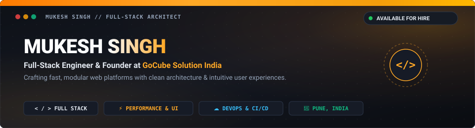

<p align="center">
  
</p>

<p align="center">
  
</p>

<p align="center">
  <a href="https://gocube.in" target="_blank">
    
  </a>
</p>

<p align="center">
  <strong>Crafting digital experiences with high performance, elegant code, and pixel-perfect design.</strong>
</p>

<p align="center">
  <a href="https://gocube.in" target="_blank"></a>
  <a href="https://wa.me/918484855008" target="_blank"></a>
  <a href="mailto:contact@gocube.in"></a>
</p>

---

### 💻 Developer Terminal

```bash
mukesh@gocube-macbook:~$ neofetch --mukesh-singh
-----------------------------------------------
OS           : macOS Sonoma (Apple Silicon)
Role         : Founder & Principal Software Architect
Company      : GoCube Solution India (gocube.in)
Location     : Pune, Maharashtra, India 🇮🇳
Primary Stack: PHP (OOP/Laravel), Modern JavaScript, Tailwind CSS, MySQL, DevOps
Focus Areas  : High-Throughput Web Apps, 100% Core Web Vitals, Enterprise CI/CD
Status       : 🟢 Available for High-Impact Projects & Architectural Consulting
Quote        : "Fast load times, modular architecture, and zero-compromise UX."
-----------------------------------------------
```

---

<details>
<summary><b>🛠️ Tech Stack & Digital Arsenal (Click to Expand)</b></summary>
<br>

<p align="center">
  <br><br>
  <br><br>
  <br><br>
  
</p>

<table>
  <thead>
    <tr>
      <th>Domain</th>
      <th>Technologies &amp; Frameworks</th>
    </tr>
  </thead>
  <tbody>
    <tr>
      <td><strong>Frontend</strong></td>
      <td>JavaScript (ES6+), TypeScript, Tailwind CSS, Bootstrap 5, Sass, Responsive HTML5</td>
    </tr>
    <tr>
      <td><strong>Backend</strong></td>
      <td>PHP 8.2+, Laravel, Node.js, Express, RESTful APIs, PHPMailer</td>
    </tr>
    <tr>
      <td><strong>Databases</strong></td>
      <td>MySQL, MariaDB, MongoDB, Redis</td>
    </tr>
    <tr>
      <td><strong>DevOps &amp; Cloud</strong></td>
      <td>GitHub Actions (Automated CI/CD), Docker, Linux (Ubuntu), Nginx, Hostinger</td>
    </tr>
    <tr>
      <td><strong>UI/UX &amp; Tools</strong></td>
      <td>Figma, Adobe Creative Suite, Postman, VS Code, Apple Silicon</td>
    </tr>
  </tbody>
</table>

</details>

---

<details>
<summary><b>🏆 Flagship Commercial Projects & Case Studies (Click to Expand)</b></summary>
<br>

<table>
  <tr>
    <td width="50%" valign="top">
      <h3 align="center">🚚 Moving Warriors</h3>
      <p align="center">
        <a href="https://www.movingwarriors.in" target="_blank">
          
        </a>
      </p>
      <ul>
        <li><strong>Domain:</strong> Pan-India Relocation &amp; Logistics Enterprise</li>
        <li><strong>Tech Stack:</strong> PHP 8.2, Compiled Tailwind CSS, Vanilla JS, PHPMailer</li>
        <li><strong>Key Highlights:</strong> Automated GitHub Actions CI/CD to Hostinger FTP, dynamic moving quote calculation, 100% mobile overlay navigation, and sub-second Core Web Vitals.</li>
      </ul>
    </td>
    <td width="50%" valign="top">
      <h3 align="center">🏢 GoCube Solution India</h3>
      <p align="center">
        <a href="https://gocube.in" target="_blank">
          
        </a>
      </p>
      <ul>
        <li><strong>Domain:</strong> Next-Generation Software Engineering &amp; Design Agency</li>
        <li><strong>Tech Stack:</strong> Full Stack Web Engineering, Modern UI/UX Architecture</li>
        <li><strong>Key Highlights:</strong> Custom digital solutions, enterprise web apps, high-performance SEO optimizations, and tailored client platforms.</li>
      </ul>
    </td>
  </tr>
</table>

</details>

---

<details>
<summary><b>📊 Real-Time GitHub Analytics & Activity Heatmap (Click to Expand)</b></summary>
<br>

<p align="center">
  
</p>

<p align="center">
  
</p>

</details>

---

<p align="center">
  <a href="https://gocube.in" target="_blank"></a>
  <a href="https://github.com/mukesh-devx"></a>
  <a href="https://wa.me/918484855008" target="_blank"></a>
</p>

<p align="center">
  <sub>⭐️ Designed &amp; Engineered with passion by <strong><a href="https://gocube.in" target="_blank">GoCube Solution India</a></strong></sub>
</p>
